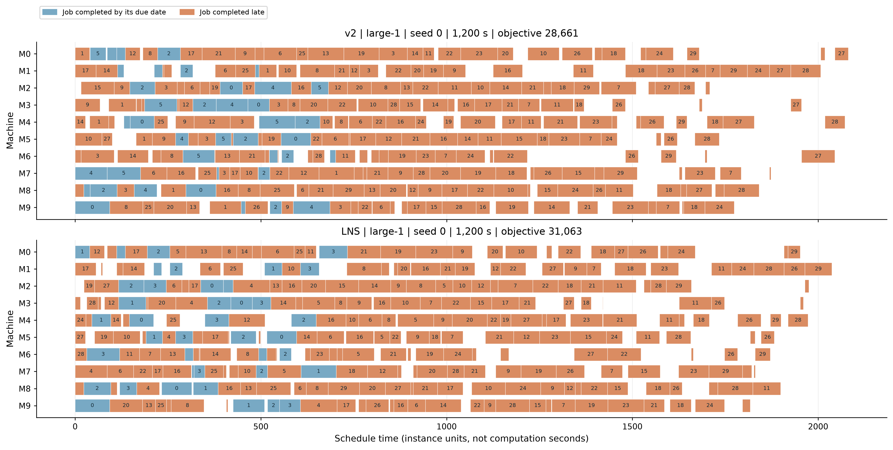
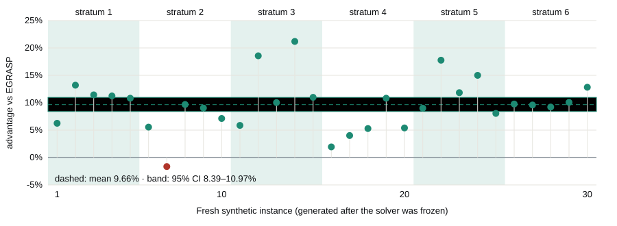
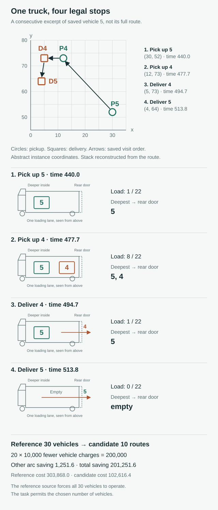

# An AI Scientist Developed Better Ways to Schedule Factories and Plan Deliveries

Using Rekursiv's open-source research stack, I developed and evaluated AI-generated algorithms for factory scheduling, delivery planning and other optimization problems. A scheduling solver outperformed a historical specialist algorithm on 29 of 30 fresh synthetic test instances by three-run mean weighted tardiness. A separate investigation evaluated one public small instance for each of FrontierOR's 180 tasks and produced five reviewed improvements over released references, including a delivery plan using 10 rather than 30 trucks and a cutting solution that reached a mathematically proven optimum.

**Venkat · Independent researcher · October 2026**

A delivery solver found a plan using ten trucks where the released benchmark reference used thirty. The reference implementation required every modeled truck to operate, even though the underlying problem allowed unused vehicles. Almost the entire difference came from that restriction, not from finding dramatically shorter routes.

The factory-scheduling experiments revealed something different. One algorithm finished the workload earlier but produced a worse result because more important jobs were delayed. And good results on familiar benchmark instances meant little without testing the algorithm on new problems.

I wanted to understand how the agent arrived at these results, what it had discovered, and whether the results held up when checked.

## Why I built on Sagent and Trackinizer

I began using Rekursiv to study how an AI agent approached research: how it studied an unfamiliar problem, investigated existing methods, proposed algorithms, tested ideas and decided what to try next.

[Sagent](https://github.com/rekursiv-ai/sagent) offered an open-source starting point. [Trackinizer](https://github.com/rekursiv-ai/trackinizer) connected hypotheses, experiments and conclusions. Being open source mattered because I wanted the freedom to inspect the system, experiment with different research workflows and improve the tools as I discovered their limitations.

I chose mathematical optimization because I could run the proposed solutions, measure their results and check whether they satisfied the constraints. [FrontierOR](https://huggingface.co/datasets/frontieror/FrontierOR) provided 180 different tasks to investigate.

## Inside the factory: from a research problem to a working solver

The starting point was bierwirth2017, one of the 180 tasks in [FrontierOR](https://huggingface.co/datasets/frontieror/FrontierOR). It describes a factory with thirty jobs moving through ten machines. Each job follows a prescribed sequence, no machine can do two operations simultaneously, and finishing late carries a penalty that depends on the job's importance. The goal is to minimize total weighted tardiness, not simply to finish the final job as early as possible.

I wanted a reusable program that could search for a good schedule on any compatible input. I supplied the formulation, public instances and evaluation requirements. [Sagent](https://github.com/rekursiv-ai/sagent) investigated approaches and wrote solver variants; Codex helped with the initial baselines, experimental runner and validation tools.

For the first scheduling study, I built a custom research loop around Sagent, with Codex helping develop the experimental infrastructure. The agent could inspect previous work, register source-hashed solvers through SaveSolver, evaluate them through EvaluateSolver and record what it learned through RecordConclusion. Our custom workflow made that conclusion step mandatory, something the public Sagent CLI did not enforce. The runner preserved schedules and execution logs, while FrontierOR's checker and a separate validator verified feasibility and recalculated the objective. [Trackinizer](https://github.com/rekursiv-ai/trackinizer) connected the resulting research records.

Sagent's main C++ solver represented a schedule through the order of operations on each machine. Move one operation forward in a queue, and work on several other machines may start earlier or later. A proposed order can even create impossible dependency cycles. The program combined established critical-path and tabu-search ideas to evaluate legal moves, discourage immediate reversals and restart from promising schedules when progress stalled.

<!-- FIGURE_SLOT: MACHINE_ORDER_INTERACTIVE -->

*Figure 1. Scheduling illustration: reordering the same work reduces the lateness penalty from 16 to 4.*

### Making the solver more efficient

Sagent [revised the solver to evaluate schedule changes more efficiently](https://github.com/Venkat-RJ/openresearch/blob/main/frontieror/publication/study-evidence/scheduling/research-decision.json). The initial solver repeatedly rebuilt machine-precedence links when assessing a move and restarted from a limited variety of schedules. Sagent proposed a second version that updated only affected links, reused calculations within an evaluation, stopped evaluating candidates whose accumulated penalty could no longer improve the result, and kept more varied restart schedules.

In the first equal-budget comparison, V2 improved on V1 across all five familiar public large instances. On large_1, weighted tardiness fell from 31,807 to 30,579 under a requested 300-second budget. On large_4, however, V2 still trailed FrontierOR's released reference. The [recorded conclusion](https://github.com/Venkat-RJ/openresearch/blob/main/frontieror/publication/study-evidence/scheduling/research-decision.json) proposed another five-case comparison with a different random seed before committing to longer runs. V2 improved on V1 across all five cases again. The next recorded direction was to extend the budget and investigate a separate constraint-programming approach. Testing a different algorithm family would show whether it could find useful schedules that the local-search approach had missed.

### Why finishing earlier was not enough

Sagent also built an alternative combining CP-SAT with large-neighborhood search. On the public large_1 development case, with a requested 1,200-second budget and seed zero, it finished the factory's workload earlier than V2, at simulated time 2,037 instead of 2,081, yet had a worse weighted-tardiness score: 31,063 versus 28,661. Completing all operations sooner did not offset lateness on more consequential jobs. The machine schedules make that difference visible.

*Figure 2. Earlier completion can still mean a higher lateness penalty. Development schedules shown in processing-time units.*

The development runs showed which revisions were worth testing further. They did not yet establish how the solver would perform on unfamiliar factory problems.

## Testing the solver on unfamiliar factory problems

The revised C++ solver eventually produced lower weighted-tardiness penalties than the released Gurobi incumbents on all five public large instances, under both tested seeds. Those incumbents are feasible recorded solutions, not proofs that no better schedule exists. And these were the very instances that had influenced development. We needed a different comparison to learn whether the solver worked beyond them.

That led back to the original research behind the task. Bierwirth and Kuhpfahl's [2017 paper](https://doi.org/10.1016/j.ejor.2017.03.030) describes EGRASP, a specialized scheduling method. We obtained the authors' [historical 2014 executable](https://prodlog.wiwi.uni-halle.de/forschung/research_data/2623675_2768180/?lang=en) to compare the developed solver with a specialist implementation on unfamiliar problems.

Getting the two programs to solve equivalent problems required input conversion and independent schedule checks. EGRASP could even write valid output while exiting with an unusual status, so a process exit code was not a reliable measure of success.

The first synthetic comparison revealed a problem with the test. On eight of twelve cases, both methods achieved zero tardiness. Those schedules were as good as possible, but the instances were too easy to distinguish the algorithms. I tightened deadlines in the development generator and ran further development checks.

Only then did we freeze the solver, generator settings, evaluation procedure and analysis before generating thirty new synthetic scheduling problems. Thirty instances × three runs × two algorithms produced 180 scheduling executions, distinct from the later campaign across 180 different tasks. Both used the same emulated Linux environment, one CPU quota, 512 MiB and a common 300-second external deadline. The [methodology notes](https://github.com/Venkat-RJ/openresearch/blob/main/frontieror/METHODS.md#scheduling) document the protocol, historical baseline and comparison limits.

All [180 final executions](https://github.com/Venkat-RJ/openresearch/blob/main/frontieror/scheduling-study/final/results.json) produced valid schedules. The Sagent-developed solver achieved a lower three-run mean weighted-tardiness penalty on 29 of the 30 new problems; EGRASP performed better on one. Across those thirty instances, its mean normalized advantage was 9.66%. The [analysis](https://github.com/Venkat-RJ/openresearch/blob/main/frontieror/scheduling-study/final/analysis.json) uses the normalization defined in the methodology notes.

*Figure 3. Three-run mean weighted-tardiness comparison: the developed solver led on 29 fresh instances; EGRASP led on one.*

The completed solver performed well on new inputs from the tested distribution against a historical specialist method. The C++ program can be run on further compatible inputs without repeating the research session that produced it.

## From one solver to 180 different problems

The scheduling experiment had produced one reusable solver and tested it across thirty new instances. But FrontierOR contains 180 different optimization tasks, from routing and production planning to graph problems. Solving them would require different algorithms, constraints and validation methods.

I wanted to understand whether the research process could work across those different problems, rather than succeeding only on factory scheduling.

### The earlier large-instance campaign

I began with a broader investigation using Sagent's CLI and a separate evaluation harness. That campaign targeted public large instances but encountered execution failures, resource limits and incomplete research histories. I paused it before all planned evaluations had finished, although [seven saved results](https://github.com/Venkat-RJ/openresearch/tree/main/frontieror/public-large-campaign) in graph coloring and hyperplane covering passed additional checks against their incumbent references.

### A separate campaign across 180 small tasks

I then ran a separate campaign across the 180 public small tasks, with six Sagent workers each assigned thirty tasks. This was a different experiment, with its own execution budget, orchestration and evaluation records.

Candidate programs ran under FrontierOR's Docker evaluator with a standard 300-second budget, one CPU and 2 GB of memory. Sagent CLI provided the agent interface, Trackinizer retained records explicitly written to it, and external orchestration handled evaluations and later checks. Unlike the scheduling study, this workflow did not automatically enforce the full hypothesis-to-conclusion sequence.

<!-- STACK_DIAGRAM -->

### Results across the 180 tasks

The campaign attempted all 180 public small tasks. After eight targeted follow-up evaluations, I [selected one result per task](https://github.com/Venkat-RJ/openresearch/tree/main/frontieror/public-small-180). Of those 180 selected results, 177 were checker-feasible outputs, but that did not mean 177 improvements. Most matched or trailed their released references. After auditing apparent gains and excluding numerical artifacts or unequal comparisons, five tasks remained with reviewed reference improvements: four larger gains and a marginal 0.00232% difference in bus-duty scheduling. Three tasks had no accepted output.

The saved decisions in the successful cases let us investigate why their solutions differed from the references.

| Investigation | What was evaluated | Main finding |
| --- | --- | --- |
| Factory scheduling | One frozen solver against EGRASP on 30 fresh synthetic instances; three runs per method | Lower three-run mean weighted tardiness on 29 of 30 instances. |
| Earlier public-large campaign | A broader task campaign, paused before all planned evaluations finished | Seven saved improvements in graph coloring and hyperplane covering passed additional checks. |
| Later public-small campaign | One public small instance for each of 180 different tasks | 177 checker-feasible outputs; five reviewed reference improvements, including one marginal gain. |

## A delivery plan that the reference could not express

One task required thirty pickup-and-delivery requests to be served within time windows and capacity limits, with a strict last-in-first-out loading rule. If a truck picked up request 5 and then request 4, it had to deliver 4 before 5. A route that looked short could still be illegal because of its loading sequence.

*Figure 5. Saved delivery sequence: two requests share a truck, using 8 of its 22 load units.*

The candidate used paired insertion and destroy-and-repair search to combine requests while checking these constraints. It returned ten operating trucks instead of thirty, with a modeled objective of 102,616.4 versus the released reference's 303,868.

The 66.23% difference in the benchmark's modeled cost was overwhelmingly about the reference's fleet restriction. The [reference code](https://github.com/Venkat-RJ/openresearch/blob/main/frontieror/public-small-180/featured-evidence/cherkesly2015/reference.py#L194-L218) set the number of modeled vehicles equal to the thirty requests and required every one to operate, although the task permitted unused vehicles. At 10,000 cost units per operating truck, avoiding twenty mandatory departures accounted for 200,000 of the 201,251.6-unit difference, or roughly 99.4%. Only 1,251.6 units came from lower travel costs.

[Route checks](https://github.com/Venkat-RJ/openresearch/tree/main/frontieror#delivery) confirmed feasibility and recomputed the objective. The plan establishes that ten trucks suffice for this input; the minimum fleet remains unknown. The released implementation could optimize its routes, but could not discover savings that required operating fewer trucks.

## A cutting plan with a mathematical proof

The cutting task involved a 40 × 40 sheet and guillotine cuts, which must pass all the way across the rectangle being divided. The released reference recovered 1,592 units of value. A dynamic-programming solver developed in the campaign produced forty one-unit-wide strips, each divided into ten 1 × 4 pieces. That is 400 useful pieces from 399 legal cuts, with no unused area.

*Figure 6. Cutting sequence reconstructed from the saved solution, including midpoint cuts.*

The candidate's value was 1,600. For this instance, each piece was worth its area, and the sheet contained exactly 1,600 square units. That gives an upper bound no legal plan can exceed. The [validated construction](https://github.com/Venkat-RJ/openresearch/tree/main/frontieror#cutting) reached it, so this particular instance was solved optimally.

The released code also used a symmetry filter that excluded exact midpoint cuts. The saved candidate used 41 such cuts. This identifies legal decisions outside the reference's filtered search, but it does not establish that the filter alone caused the eight-unit difference. The area bound and validated construction establish optimality regardless of the filter's effect.

Three other small-task results survived the review, although their practical significance varied:

| Task | Comparison with the released reference | Context |
| --- | --- | --- |
| Transit line planning | Weighted objective 48.23% lower | Passenger travel time increased; the cheaper plan involved a trade-off. |
| Kitchen production and delivery | Modeled objective 14.18% lower | A feasible improvement for the saved instance, not a claim of global optimality. |
| Bus-duty scheduling | Modeled objective 0.00232% lower | An extremely small difference with unresolved interpretation of a reference label. |

The [research repository](https://github.com/Venkat-RJ/openresearch/tree/main/frontieror) also includes the additional figures, unsuccessful attempts and seven checked improvements from the earlier, incomplete large-instance campaign. The table above covers the remaining three improvements from the separate small-task campaign.

## When research improves the tools

Not every problem I encountered was an optimization problem.

The first scheduling study used a custom workflow that connected solver versions, evaluations and conclusions. But when I expanded to longer research sessions with multiple Sagent workers, the orchestration itself became harder to manage. Some [commands could time out while leaving child processes running](https://github.com/rekursiv-ai/sagent/issues/602). Background-worker messages needed clearer attribution, and it wasn't always easy to tell which experiments had completed or required attention.

I investigated these problems alongside the research, reported reproducible failures and contributed proposed improvements to Sagent and WeSearch. The [reported timeout cases were subsequently fixed upstream and passed my regression checks](https://github.com/rekursiv-ai/sagent/issues/602#issuecomment-6021768989). Other proposed changes addressed [worker-message attribution](https://github.com/rekursiv-ai/sagent/pull/633), search coverage and [progress visibility](https://github.com/rekursiv-ai/sagent/pull/636). The worker-attribution and progress-visibility pull requests remain open; they are not yet merged into the upstream stack.

Reliable research depends on knowing which experiment ran, what it returned and which worker produced it. These practical failures gave me another way to contribute to the open-source research stack, alongside the solver experiments.

<!-- STACK_SETUPS_AND_EVIDENCE -->

## The next challenge: Making AI better at research

These experiments raised another question: can an AI scientist become better at deciding what to investigate next?

Sagent and Trackinizer already provide much of the foundation for agent coordination, experimentation and research evidence. I want to build on that foundation to explore smarter hypothesis selection, compute allocation and learning across experiments.

FrontierOR's 180 problems offer a testing ground: discovering stronger algorithms, evaluating them against specialist baselines and investigating which techniques transfer between problems. I'll continue contributing improvements to the open-source stack along the way.

<!-- RESEARCH_PLANNING_PROPOSAL -->

**The first challenge was finding better algorithms. The next is finding better ways for AI scientists to discover them.**

---

### Research materials

The [research repository](https://github.com/Venkat-RJ/openresearch/tree/main/frontieror) contains the results, solver code, inputs, saved solutions and validation records for all three studies. Its study guide shows where to find each part, download the files and run the saved-result checks. The [methods](https://github.com/Venkat-RJ/openresearch/blob/main/frontieror/METHODS.md) cover the evaluation setup, comparison limits and model provenance.

These experiments measured modeled benchmark outcomes, rather than savings in operating businesses. Validation was performed within this project with human direction and Codex support; independent external replication has not been demonstrated.
